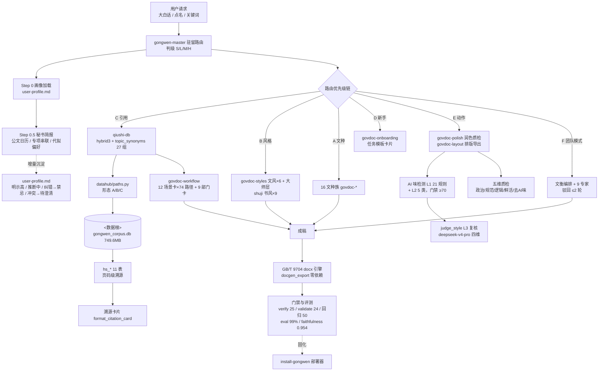

# 公文大师 skill 套件架构与运作逻辑（v8.1.10）

> 更新：2026-09-29 ｜ 对应 `VERSION = 8.1.10`（版本号同步订正，正文架构描述未变）
> 口径：**26 个受治理技能（1 顶层 master + references/ 嵌套模块）+ 1 个退役安装器 = 29 个一级模块目录**
> 本文为架构单一权威副本；`architecture.html` 与内联 SVG 为 v7.1.2 期产物，已过期，以本文为准。
> **v8.0.0 注记（2026-09-21）**：本图描述 v7 多技能布局。v8.0.0 起交付形态为**单技能** gongwen-master：
> 24 个能力模块下沉为包内嵌套 `references/{模块}/SKILL.md`（按需加载），datahub 收入包内，
> 安装器退役。图中「能力层」对应 v8 嵌套模块，模块名、路由规则 A–F 与判级机制不变。

---

## 一、七层架构总览

```
┌───────────────────────────────────────────────────────────────────────────┐
│ ① 接入层       宿主 agent 扫描 SKILL.md frontmatter（name/description/tags）│
│                入口形态：自然语言 · 点名触发「公文大师」· 关键词           │
└─────────────────────────────────┬─────────────────────────────────────────┘
                                  ▼
┌───────────────────────────────────────────────────────────────────────────┐
│ ② 路由与秘书层 gongwen-master v8.1.10（单一入口 · 会话驻留 · 判级 S/L/M/H）│
│   Step 0    画像加载（user-profile.md）+ 轻触采集（≤2 问，不阻断写作）     │
│   Step 0.5  秘书简报 ≤3 行（公文日历 / 专项串联 / 代拟偏好套用）           │
│   Step 1    意图粗分类（10 分支）                                          │
│   Step 2    细分类（以规则 A–E 表为唯一权威，不再维护第二套表）           │
│   Step 2.5  关键词前置匹配：规则 A 文种 / B 风格 / C 引用 / C2 本地数据 /  │
│             D 新手 / E 动作  →  规则 F 团队模式（正交开关）                │
│   优先级链  C > B > A > D > E（含新手信号时 D 提前）> E               │
│   └→ 语义路由兜底 semantic_router.py（阈值 0.55，93%/90 条）              │
│      └→ 五维意图解析 → LLM 语义 → Step 4 保底框架骨架                      │
└─────────────────────────────────┬─────────────────────────────────────────┘
                                  ▼
┌───────────────────────────────────────────────────────────────────────────┐
│ ③ 能力层（24 受治理技能）                                                  │
│  文种族 16×govdoc-*  │ 动作族 polish · layout · material · corpus │ 风格族 styles · shuji │
│  流程族 workflow（12 场景卡 × 74 文书路径 + 9 部门卡）                     │
│  评审族 article-review（A 六步分析 / B 1 主理人+5 专员核查）              │
│  数据族 qiushi-db（hybrid3 五模式 + 溯源卡片）                            │
│  共享契约 → references/shared-templates.md（v8.0.0 包内）                  │
└─────────────────────────────────┬─────────────────────────────────────────┘
                                  ▼
┌───────────────────────────────────────────────────────────────────────────┐
│ ④ 团队模式层（规则 F 触发 · 正交于路由链）                                 │
│   文衡(编排) ─┬─ 章仪(文种) 笔致(文风) 据实(数据) 校书(质检) 证微(核查)    │
│               ├─ 法鉴(涉法强制)                                           │
│               └─ 章策/城构/枢垣(会诊三杰)                                 │
│   契约：team-orchestration + team-scenarios + team-roster；驳回 ≤2 轮      │
└─────────────────────────────────┬─────────────────────────────────────────┘
                                  ▼
┌───────────────────────────────────────────────────────────────────────────┐
│ ⑤ 数据层  datahub/（assets.json 台账 + dataloader.py + paths.py 解析器）   │
│   ★ paths.py 解析序：GONGWEN_DATA_ROOT → assets.json:data_root →           │
│                      内置默认(<数据根>) → 包内 datahub/ 回退          │
│     形态：A 外置可用 / B 包内可用 / C 降级（显式提示，不静默）             │
│   合并库 gongwen_corpus.db 749.6MB / 49 表 / 约 18.0 万行（非阴影表）       │
│   引擎：qs/qiushi_engine.py(hybrid3) · 爬虫三件套      │
└─────────────────────────────────┬─────────────────────────────────────────┘
                                  ▼
┌───────────────────────────────────────────────────────────────────────────┐
│ ⑥ 交付层  govdoc-polish（五编辑模式 + AI 味检测 ≥70 + 五维质检）       │
│           → govdoc-layout（GB/T 9704 .docx：docgen_export 7 模块零依赖     │
│             或 export_govdoc python-docx）→ 溯源附注                       │
└─────────────────────────────────┬─────────────────────────────────────────┘
                                  ▼
┌───────────────────────────────────────────────────────────────────────────┐
│ ⑦ 门禁与治理层                                                             │
│   verify_install 25 · validate_skills 26/26 · rules_regression 66/66 ·     │
│   run_eval 100%/MRR 0.974 · faithfulness 0.954 · schema 27 表 · ddl 一致 · │
│   skills_manifest 无漂移 ｜ registry.json 台账 · upgrade · install-gongwen │
└───────────────────────────────────────────────────────────────────────────┘
```

---

## 二、调用关系与数据流转（Mermaid）



---

## 三、单次请求的生命周期（时序）

```
用户：「写份工作汇报并引用地方 2024 年 GDP」

① 接入     宿主 agent 命中 gongwen-master description → 加载 SKILL.md
② 驻留声明  首次激活播报（含"下一步建议=在线指示灯"契约）
③ Step 0   读 user-profile.md；无则轻触采集（≤2 问，不阻断）
④ Step 0.5 秘书简报 ≤3 行（到期提醒/专项对齐/代拟偏好）
⑤ Step 1   意图粗分类 → 写作类 + 数据类（双信号）
⑥ Step 2.5 关键词前置：
             A 命中「工作汇报」→ govdoc-report
             
             
⑦ 取数     qiushi-db → datahub/paths.py → 形态 A → gongwen_corpus.db
             → articles（正文表）
             → 返回「2024 地区生产总值 2,305.81 亿元 → 2025年鉴.pdf p.49」+ 原文摘录
⑧ 判级     单文种 + 引用 → L 级 → 派 1 专家（2-3x 成本）
⑨ 写作     加载 govdoc-report/SKILL.md → 四步工作流 + formulas.md
             六步法：定调 → 立骨 → 起笔 → 填肉(四柱论证) → 润色 → 收口
⑩ 交付     回复 = 成稿 + 「公文大师下一步建议」(2-3 条编号) ← 在线指示灯
⑪ 后续     用户说「(1)」→ 执行该建议 → 再给新一轮建议（驻留迭代循环）
             若走质检/排版：polish → AI 味检测(≥70) → 五维质检 → layout → docx
```

**失败与降级路径**

| 情形 | 处理 |
|---|---|
| 目标子技能缺失 | Step 4 保底框架骨架 + 说明"子技能未安装" |
| 关键词未命中 | 语义路由兜底（0.55）→ 五维意图 → LLM → 保底框架 |
| 数据形态 C（两处皆无数据） | 显式降级提示（可操作三步），写作能力仍可用 |
| BGE 模型缺失 | 向量路自动关闭，降级 TF-IDF+BM25 词面双路 |
| LLM Key 缺失 | 团队模式/judge 不可用，主链路不受影响 |
| 团队专家验收不达标 | 打回 ≤2 轮，仍不达标上报用户决策 |
| 用户负面反馈 | 末尾追加飞书问卷链接（references/govdoc-feedback/） |

---

## 四、四条数据流

1. **查询扩展流**：口语 query → `topic_synonyms.expand_query`（27 组词典）→ hybrid3 检索（原词 1.0 + 扩展词 0.5 半权 RRF）→ 命中率 99%
2. **画像流**：Step 0 读 `user-profile.md` → 起草直接套代拟偏好 → 成稿尾注纠偏 → 修改信号增量沉淀回画像（复利）
3. **质检流**：成稿 → AI 味检测器（L1 词汇 21 规则 + L2 结构 5 类）→ 改写建议 → L3 judge 语义复核 → 五段式质检报告
4. **交付流**：成稿 → `docgen_export`（GB/T 9704 红头/字体/页码，零第三方依赖）→ .docx + 溯源附注

---

## 五、数据底座构成（合并库七域）

```
gongwen_corpus.db（749.6MB / 49 表 / 约 18.0 万行（非阴影表））
├── 文章域   articles 20,931 篇（求是 3,456 / 红旗文稿 2,073 / 国务院公报 14,863 / 求是网 264 /
│            部委政策 188 / 法规 50 / 图书 17 / 任仲平 8 / 国务院公文 7 / 贺词 4）
│            + v_articles_corpus 视图（20,969 行七域，不含国务院公报）+ txt_corpus_index 5,556 篇 16 主题
│            + articles_fts（独立物化表，jieba 分词，标题×2 权重）
├── 领袖域   jhsjk_articles 14,901 篇 / 2,222 万字（2012-11 ~ 2026-09）
├── 书籍域   books24（11 本 92 章 303 万字全文）+ lilun_books（14,253 册索引 / 27.7 亿字）
├── 引用域   statements 31,315 + golden_quotes 31,315（排比/号召/对仗/论断四型）
└── 治理域   lineage 5 源溯源（来源库/行数/同步时间/断点）

检索层：5 套 FTS + 9 个索引；模式 hybrid3(默认) / hybrid / tfidf / bm25 / vec
        快路 GONGWEN_FAST=1（毫秒级，缺表自动降级全量路）
```

**总账**：正文在库约 3,300 万字，索引可达 27.7 亿字，时间跨度 14 年，署名作者 2,783 位。

---

## 六、分层职责速查

| 层 | 职责 | 关键组件 |
|---|---|---|
| ① 交互层 | 用户请求接入 | 大白话 / 点名 / 关键词 |
| ② 路由与秘书层 | 驻留路由 + 判级 + 画像简报 | master / Step 0·0.5 / 优先级链 / 语义兜底 |
| ③ 能力层 | 五大技能族 | 16 文种 + 风格 ×2 + 动作 ×2 + 流程 + 评审 + 数据 |
| ④ 团队层 | 多智能体编排 | 文衡 + 9 专家 + 三契约 + S/L/M/H |
| ⑤ 数据层 | 检索与记忆供能 | paths.py / dataloader / 合并库 / user-profile.md |
| ⑥ 交付层 | 成稿 → docx → 质检 | polish / AI 味检测 / layout / docgen_export |
| ⑦ 门禁治理层 | 校验 → 加固 → 部署 | 14 项门禁 + registry + upgrade + install |

---

## 七、门禁与基线（v8.1.10）

| 门禁 | 命令 | 基线 |
|---|---|---|
| 安装自检 | `python verify_install.py` | 25/25 |
| 规范校验 | `python validate_skills.py` | 26/26（真实 YAML 解析，12 规则） |
| 路由回归 | `python rules_regression.py` | 66/66（A–F 全规则，含退出码） |
| 检索评测 | `python datahub/eval/run_eval.py` | 104 条 99% / MRR 0.974 / gold_hit 74.0% |
| 忠实度 | `python datahub/eval/judge_faithfulness.py` | 0.954（阈值 0.85） |
| schema 一致性 | `python gongwen_tool.py schemas` | 27 表过检 |
| DDL 一致性 | `python gongwen_tool.py ddl --check` | 26 表 / 9 索引 / 1 视图 |
| 清单漂移 | `python skills_manifest.py` | 26 + 1 = 27，无漂移 |

> **已知边界**：语义路由阈值 0.55 为首测值待扩容后再调；地方库更新需手工。
> 详见 README「已知边界」与包根 `迭代方案_v7.3.0.md`。
